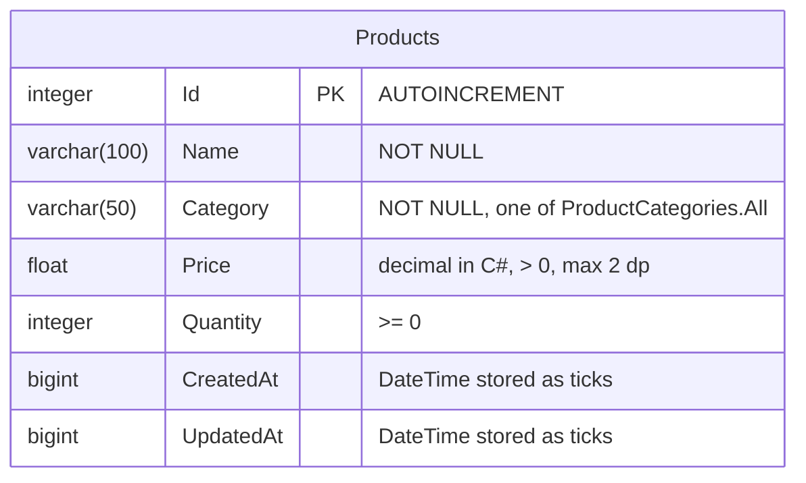

# Database design

The app stores its data in a single SQLite file, `inventory.db3`, in the app's private data folder
(`FileSystem.AppDataDirectory`). The schema is defined by the sqlite-net attributes on
`Models/Product.cs`, and `Services/ProductDatabase.cs` creates the table on first use with
`CreateTableAsync<Product>()`.

## Entity-relationship diagram



There is one table and no foreign keys. Categories are a fixed list in code
(`Models/ProductCategories.cs`), not a lookup table, so `Category` holds the category name as text.

## Columns

| Column | SQLite type | C# type | Constraints (database) | Rules (enforced in `Product.Validate()`) |
|---|---|---|---|---|
| `Id` | `integer` | `int` | `PRIMARY KEY AUTOINCREMENT` | Set by SQLite on insert; `0` means a new product |
| `Name` | `varchar(100)` | `string` | `NOT NULL` | Required, trimmed, 100 characters or fewer |
| `Category` | `varchar(50)` | `string` | `NOT NULL` | Must be one of: Electronics, Clothing, Food & Drink, Home & Garden, Office Supplies, Toys & Games, Other |
| `Price` | `float` | `decimal` | none | Greater than 0, at most 1,000,000, at most 2 decimal places |
| `Quantity` | `integer` | `int` | none | 0 to 1,000,000 |
| `CreatedAt` | `bigint` | `DateTime` | none | Set in `SaveAsync` when the product is first inserted |
| `UpdatedAt` | `bigint` | `DateTime` | none | Set in `SaveAsync` on every insert and update |

`DateTime` values are stored as .NET ticks because sqlite-net defaults to `storeDateTimeAsTicks = true`.
The validation rules live in C#, not in SQLite `CHECK` constraints, so they apply only to data saved
through the app.

## Calculated properties (not stored)

These members of `Product` are marked `[Ignore]`, so they have no column and are worked out from the
stored values each time they are read:

| Property | Derived from |
|---|---|
| `IsLowStock` | `Quantity <= 5` (`Product.LowStockThreshold`) |
| `IsOutOfStock` | `Quantity <= 0` |
| `StockLevel` / `StockStatus` | `InStock`, `Low` or `OutOfStock`, from the two flags above |
| `TotalValue` | `Price * Quantity` |
| `PriceDisplay` / `TotalValueDisplay` | Currency-formatted `Price` / `TotalValue` |
| `Initials` | First letters of `Name`, shown in the list avatar |

## Generated table

The table sqlite-net creates is equivalent to:

```sql
CREATE TABLE "Products" (
    "Id"        integer      PRIMARY KEY AUTOINCREMENT NOT NULL,
    "Name"      varchar(100) NOT NULL,
    "Category"  varchar(50)  NOT NULL,
    "Price"     float,
    "Quantity"  integer,
    "CreatedAt" bigint,
    "UpdatedAt" bigint
);
```

## Queries used by the app

| Method | Query |
|---|---|
| `GetAllAsync` | All rows, ordered by `Name` |
| `GetByIdAsync` | One row where `Id = @id` |
| `GetLowStockAsync` | Rows where `Quantity <= 5`, ordered by `Quantity` |
| `SaveAsync` | `INSERT` when `Id == 0`, otherwise `UPDATE` by `Id` |
| `DeleteAsync` | `DELETE` by `Id` |

On first run, when the database file does not exist yet, the 12 sample products from
`Services/SeedData.cs` are inserted.
